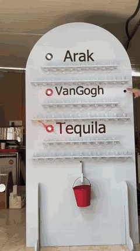
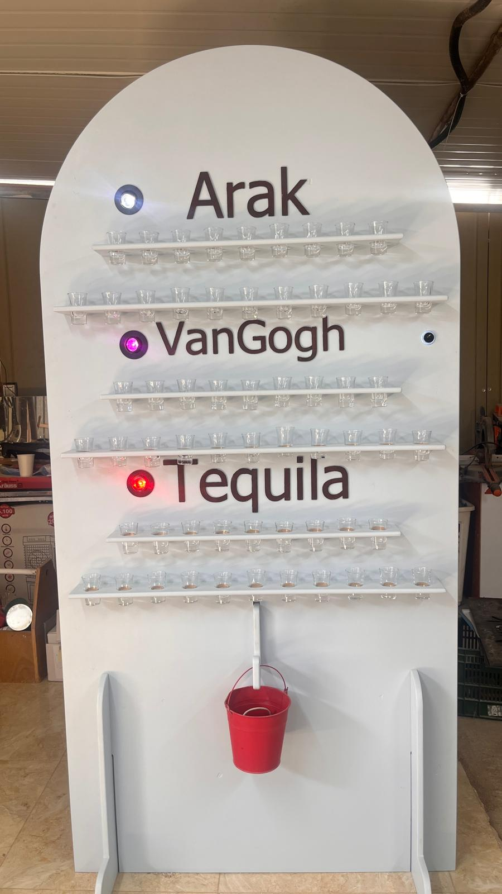
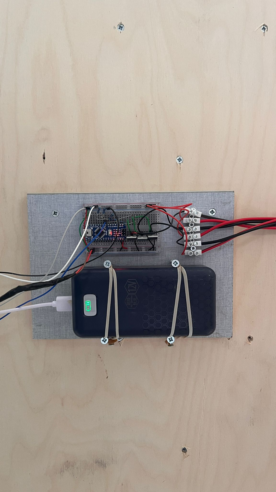
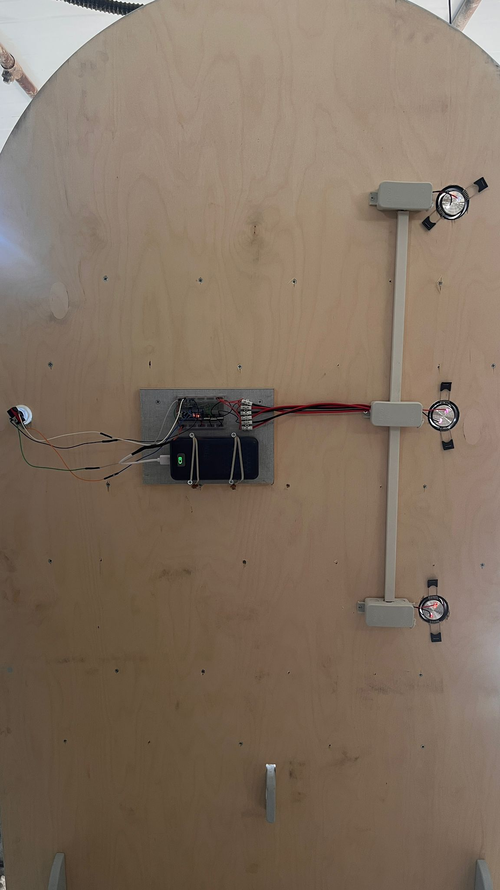

# 🎰 Drink Roulette – Arduino LED Game

A fun and interactive **Arduino-based roulette** that randomly selects a drink by lighting one of three lamps — Arak, Tequila, or Van Gogh.

---

## 🧠 Overview
When idle, all LEDs are ON.  
Pressing the button starts a fast “roulette” sequence that stops randomly on one lamp for about 10 seconds.  
Pressing again restarts the spin.  

This project demonstrates:
- Digital output control  
- Random number generation (`random()`)  
- Timing (`delay()`)  
- State management via button input  

---

## ⚙️ Hardware Setup
| Component | Quantity | Description |
|------------|-----------|-------------|
| Arduino Nano | 1 | Main controller |
| LEDs | 3 | Represent the drinks (Arak, Tequila, Van Gogh) |
| N-MOSFETs (BS170) | 3 | Drive LEDs |
| Push Button | 1 | Input trigger |
| Resistors | As needed | 220 Ω for LEDs, 10 kΩ for pull-down |
| 5 V Power Supply | 1 | Shared ground |

---

## 💻 Code
📂 [`roulette_lights.ino`](code/roulette_lights.ino)

The Arduino sketch controls LED timing, random selection, and debounce logic for the push button.

---

## 🎥 Demo

Full video: [`media/VID-20251013-WA0006.mp4`](media/VID-20251013-WA0006.mp4)

---

## 📸 Photos
| Breadboard Setup | Final Look |
|------------------|-------------|
|  |  |

Additional close-up:  

---

## 🧰 Tools Used
- Arduino IDE  
- Breadboard + jumper wires  
- Random and delay control logic  
- MOSFET switching for power stage  

---

## 👤 Author
**Asaf Refael Dabush**  
Electrical & Electronics Engineering  
B.Sc. Electrical & Electronics Engineering, Ariel University  

---

## 🪪 License
Released under the [MIT License](https://opensource.org/licenses/MIT)
